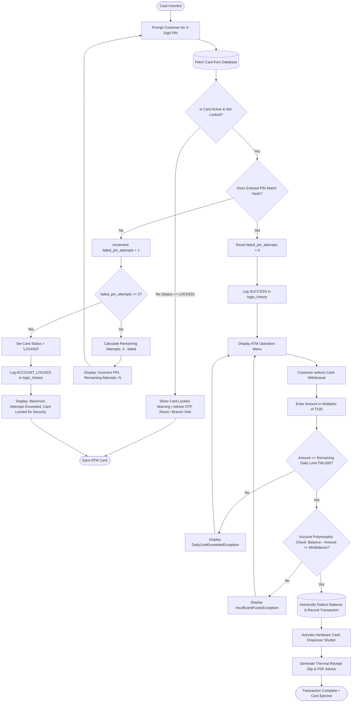

# Activity Diagram - Apex ATM Banking System

This document illustrates the operational activity workflow for **ATM PIN Verification & Security Lockout**, followed by **Cash Dispense Processing**.

