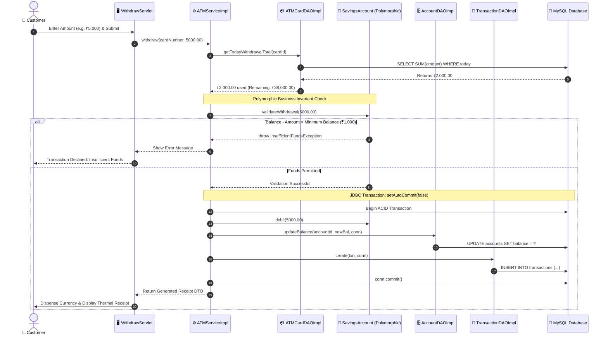
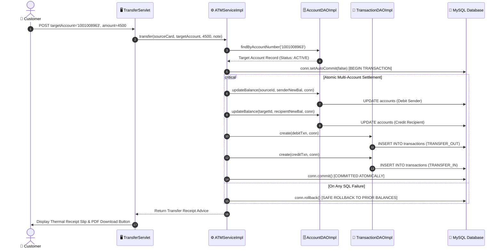

# Sequence Diagram - Apex ATM Banking Management System

This document visualizes the dynamic execution flows for two critical banking transactions: **ATM Cash Withdrawal** and **Atomic Inter-Account Fund Transfer**.

---

## 1. ATM Cash Withdrawal Sequence

---

## 2. Inter-Account Atomic Money Transfer Sequence

