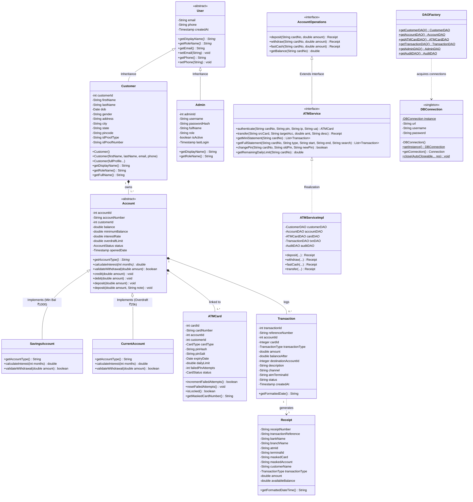

# UML Class Diagram - Apex ATM Banking Management System

This document provides the formal UML Class Diagram for the **Apex ATM Banking Management System**, showcasing Object-Oriented Programming (OOP) principles: Abstraction, Inheritance, Polymorphism, Encapsulation, Interfaces, and Design Patterns (DAO, Factory, Singleton).

---
*Created as part of the Final Year Capstone Project for Apex ATM Banking Management System.*
