# Use Case Diagram - Apex ATM Banking Management System

This document outlines the system actors and their interactions with the ATM Banking Management System.

```mermaid
flowchart TD
    subgraph Actors
        Customer["👤 ATM Cardholder / Customer"]
        Admin["👮 System Administrator / Bank Manager"]
        BankDB[("🗄️ MySQL Database Engine")]
    end

    subgraph "ATM & Self-Service Banking Subsystem"
        UC1(["Insert Card & Authenticate PIN"])
        UC2(["Cash Withdrawal"])
        UC3(["Cash Deposit"])
        UC4(["Fast Cash 1-Click Dispense"])
        UC5(["Balance Enquiry"])
        UC6(["Mini Statement (Last 10)"])
        UC7(["Full Statement Filter & PDF"])
        UC8(["Inter-Account Money Transfer"])
        UC9(["Change ATM PIN"])
        UC10(["Simulated OTP Forgot PIN"])
        UC11(["Download & Print Thermal Receipt"])
    end

    subgraph "Admin & Branch Management Subsystem"
        UC20(["Administrator Login"])
        UC21(["Customer Directory Management (CRUD)"])
        UC22(["Account Freeze / Activation"])
        UC23(["ATM Card Unlock / Reset Failed PIN Attempts"])
        UC24(["Global Transaction Inspection"])
        UC25(["Generate Financial Audit Reports"])
    end

    %% Customer Associations
    Customer --> UC1
    Customer --> UC2
    Customer --> UC3
    Customer --> UC4
    Customer --> UC5
    Customer --> UC6
    Customer --> UC7
    Customer --> UC8
    Customer --> UC9
    Customer --> UC10

    UC2 -.->|include| UC11
    UC3 -.->|include| UC11
    UC4 -.->|include| UC11
    UC8 -.->|include| UC11

    %% Admin Associations
    Admin --> UC20
    Admin --> UC21
    Admin --> UC22
    Admin --> UC23
    Admin --> UC24
    Admin --> UC25

    %% Database Sync
    UC2 --> BankDB
    UC3 --> BankDB
    UC8 --> BankDB
    UC21 --> BankDB
    UC22 --> BankDB
```

### Use Case Actors & Responsibilities

1. **ATM Cardholder / Customer**:
   - Inserts electronic debit card and authenticates using a 4-digit PIN.
   - Performs self-service cash withdrawals, deposits, fast cash, and transfers.
   - Accesses live account balances, mini statements, and generates downloadable PDF receipts.
   - Protected by 3-attempt security locks and simulated OTP verification.

2. **Bank Administrator / Manager**:
   - Oversees customer profiles (add, modify, delete).
   - Enforces risk controls (freezing suspicious accounts, unblocking cards).
   - Generates executive balance sheets and audit trail reports.
